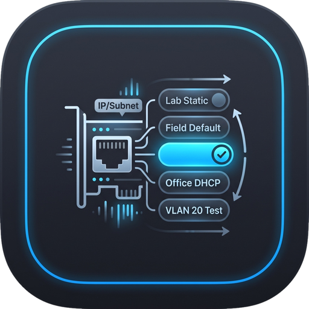

# IP Profile Switcher (NIC Quick-Config)

<p align="center">
  
</p>

A high-performance, dark-first desktop network adapter configuration utility built with **Flutter Desktop** and an embedded **SQLite** preset engine for **Windows, macOS, and Linux**.

Part of the **Network Suite** family of standalone network utilities.

---

## 🎯 Executive Summary & Purpose

Field technicians, network engineers, and system administrators constantly plug into different equipment requiring static IPv4 subnets (e.g., `192.168.1.50/24` for default switches, `10.0.0.100/24` for industrial PLCs, `172.16.20.50/24` for VLAN tests, or `2.x.x.x/8` for Art-Net/sACN lighting controllers), then switch back to `DHCP` for general office access. Manually navigating native OS adapter control panels every time is slow and error-prone.

**IP Profile Switcher (`ip-setter`)** solves this by letting you save one-click adapter presets (`"Lab Static"`, `"Field Default"`, `"Office DHCP"`, `"VLAN 20 Test"`) that instantly reconfigure IPv4 address, Subnet Mask / CIDR, Default Gateway, DNS servers, and secondary alias IPs on any chosen network interface.

---

## 🚀 Key Features

- **One-Click NIC Presets & On-Demand Demo Data**:
  - Save, pin, search, and categorize Static IPv4 or Automatic DHCP profiles.
  - Starts with a clean workspace; load or reload the curated field/lab sample presets at any time with the **Demo Presets** (`Icons.auto_awesome`) button in the top bar or empty state.
  - Supports primary IPv4 + CIDR/Subnet Mask, Default Gateway, Primary & Secondary DNS servers, optional secondary alias IPs (multi-homing), informational VLAN tags, and custom MTU.
  - Includes a **Quick DHCP** emergency button in the top bar to immediately restore the selected adapter to pure automatic DHCP + DNS.
  - **Pre-Mutation Snapshot ("1-Click Undo")** & **Automatic Rollback**: Captures the live adapter configuration before applying any preset so you can undo a switch with a single click, and automatically rolls back if a live apply command fails.

- **Custom Color-Coded Category Filters**:
  - Dedicated **Categories** filter bar with multi-select `FilterChip` pills displaying each category's assigned color badge, name, and live preset count (`e.g., LAB (3)`).
  - Click any category pill to toggle filtering, click its inline edit icon (or right-click the pill) to change its name or color swatch on the fly, or click **+ Add Category** to create your own custom categories (`STAGE`, `CCTV`, `PLANT FLOOR`, etc.).
  - Includes a **Manage Filter Categories** dialog (`Categories` button) to toggle filter bar visibility, edit colors/names (automatically updating linked presets), or delete categories.

- **Real-Time NIC Telemetry & Side-by-Side Diffing**:
  - Polls live OS network interfaces (`netsh` / PowerShell on Windows, `networksetup` / `ifconfig` on macOS, `nmcli` / `iproute2` on Linux) with automatic periodic background refresh.
  - Displays live link status (`LINK UP` / `LINK DOWN`), hardware MAC address, active IPv4/CIDR, Subnet Mask, Default Gateway (with post-apply ICMP ping latency badge), and per-interface DNS servers.
  - **Summary & NIC Diff Inspector**: Compares *Current Live NIC* vs *Target Preset State* side-by-side, highlighting fields that will change in `#F59E0B`.

- **Transparent OS CLI Command Preview & Dry-Run Mode**:
  - View and copy the exact generated native OS commands (`netsh`, `networksetup`, `nmcli` / `ip`) inside a `#0F141C` command preview card, with a toggle to inspect commands for Windows, macOS, or Linux.
  - **Dry-Run / Simulation Mode**: Test preset switches and inspect generated commands safely without modifying host OS network adapters, highlighted by a `#F59E0B` amber border around the preset table.

- **Bidirectional Subnet Mask ↔ CIDR Calculator**:
  - Typing `/24` automatically populates `255.255.255.0` (and vice versa) and calculates the usable host range (`Net: 192.168.1.0/24 • Range: 192.168.1.1 – 192.168.1.254`).
  - **Snapshot Active NIC**: One-click button to capture the currently connected interface's live settings into a new preset.

- **5-Tier Desktop Architecture**:
  1. **Top Control Bar**: App icon & title, live Target NIC selector, Refresh NICs, New Preset, Quick DHCP, Undo switch, Demo Presets, JSON Import/Export, Clear Presets, and Dry-Run Mode checkbox.
  2. **Conditional Alert Banner**: Displays active preset application progress, errors, and gateway reachability telemetry.
  3. **Live NIC Telemetry Strip & Dual-Row Filter Toolbar**: Real-time adapter metrics, instant search input, mode filter chips (`ALL`, `FAVORITES`, `STATIC`, `DHCP`), and color-coded category filter pills.
  4. **Virtualized Resizable Presets Table**: Drag-resizable columns, numeric IPv4 sorting, monospace technical cells, active preset detection (`ACTIVE` vs `READY`), and one-click `Apply` / `Re-Apply`.
  5. **Collapsible Bottom Detail Inspector & Persistent Status Bar**: Diff & Summary tab, CLI Command Preview tab, and Execution Logs tab.

- **Clean Process Lifecycle**:
  - Implements `WidgetsBindingObserver.didRequestAppExit` to ensure zero orphaned background ping or OS network configuration subprocesses upon closing the application.

---

## 🛠️ Architecture

Follows the canonical architecture from `UI_AND_DESIGN_PRINCIPLES.md`:

```text
lib/
├── core/
│   └── constants.dart                   # App configuration, versioning & publisher metadata
├── theme/
│   └── app_theme.dart                   # Material 3 Dark theme (#141414 / #1E1E1E / #007ACC)
├── domain/
│   └── models/
│       ├── command_execution_log.dart   # CLI execution stdout/stderr & exit code log
│       ├── ip_profile_model.dart        # Saved preset entity & validation
│       ├── ipv4_utils.dart              # Bidirectional CIDR <-> Subnet Mask & range calculator
│       ├── network_interface_model.dart # Live NIC telemetry & profile matching
│       ├── profile_category_model.dart  # Custom color-coded category rules
│       └── profile_diff_model.dart      # Current NIC vs Target Preset diff solver
├── data/
│   ├── repositories/
│   │   ├── nic_repository.dart          # Adapter discovery, snapshots & preset execution
│   │   └── profile_repository.dart      # SQLite CRUD, category persistence & JSON import/export
│   └── services/
│       ├── database_service.dart        # SQLite storage, schema migrations & log pruning
│       ├── demo_profile_generator.dart  # On-demand field/lab demo presets
│       ├── gateway_ping_service.dart    # Post-apply ICMP gateway reachability verifier
│       └── nic_backend_service.dart     # Cross-platform netsh, networksetup & nmcli/ip runner
└── ui/
    ├── view_models/
    │   └── ip_setter_view_model.dart    # ChangeNotifier state coordinator
    ├── views/
    │   └── main_screen.dart             # 5-tier desktop screen layout & lifecycle observer
    └── widgets/
        ├── bottom_detail_inspector.dart # 3-tab Diff, CLI Preview & Execution Log drawer
        ├── category_dialogs.dart        # Add/Edit Category color picker & Manage Categories modal
        ├── filter_triage_toolbar.dart   # Live NIC telemetry strip, search & category pills
        ├── import_export_dialog.dart    # JSON preset bundle import/export modal
        ├── profile_data_table.dart      # Virtualized resizable preset table with Dry-Run border
        ├── profile_editor_dialog.dart   # Preset editor with live CIDR/subnet calculator
        ├── status_alert_banner.dart     # Execution & gateway status banner
        ├── status_badge.dart            # Canonical 15% opacity status pill
        └── top_control_bar.dart         # Target NIC selector, Quick DHCP & primary actions
```

---

## 📦 Building and Running

### Prerequisites
- [Flutter SDK](https://flutter.dev/docs/get-started/install) (3.13+)
- Desktop C++ build toolchains:
  - **Windows**: Visual Studio 2022 with "Desktop development with C++"
  - **macOS**: Xcode & Command Line Tools
  - **Linux**: `clang`, `cmake`, `ninja-build`, `pkg-config`, `libgtk-3-dev`, `liblzma-dev`, `libsqlite3-dev`

### Clone & Run in Debug Mode
```bash
git clone https://github.com/Tom-McGuire/IP-Switcher.git
cd IP-Switcher
flutter pub get
flutter run
```

### Run Tests
```bash
flutter analyze
flutter test
```

### Build Platform Binaries
```bash
# Windows (x64)
flutter build windows --release

# Linux (x64)
flutter build linux --release

# macOS (Universal)
flutter build macos --release
```

---

## ⚠️ Security & Code Signing Notes

> **Note on Windows / macOS Security Prompts:**
>
> These tools are free, open-source community utilities and are not signed with expensive commercial developer certificates:
>
> - **Windows**: If Microsoft Defender SmartScreen appears with *"Windows protected your PC"*, click **"More info"** → **"Run anyway"**.
> - **macOS**: Right-click the `ip_setter.app` (or `IP Profile Switcher.app`) bundle in Finder, select **Open**, and confirm the dialog (or run `xattr -cr /path/to/ip_setter.app` in Terminal).

---

## 📄 License

MIT License. Copyright (c) 2026 Tom McGuire. See [LICENSE](LICENSE) for details.
